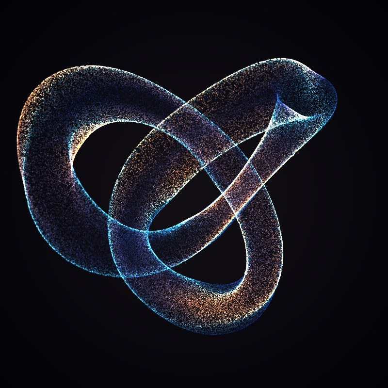

# 本来无一物，何处惹尘埃 · Dust Sculpture

**[▶ Play / 打开玩](https://lotushansstudio-maker.github.io/visual/dust-sculpture/)**

（名字取自惠能偈「菩提本无树，明镜亦非台。本来无一物，何处惹尘埃」，公版。点云本来是尘，聚是雕塑，散是尘，松手又聚。English title: Dust Sculpture.）

**中文**：十几万个光点组成一座会变形的发光雕塑，带景深虚化。手指划过，光点被吹成光尘，松手后慢慢回聚；它会自己转、自己变形，共 9 个形态：三叶结、涟漪球、莫比乌斯带、旋臂星云、双螺旋、波纹环面、利萨如结、鹦鹉螺、喷泉。

**English**: Over a hundred thousand points of light form a glowing sculpture with depth of field. Swipe to blow the points into dust; let go and they slowly re-gather. It turns by itself and morphs through nine shapes: trefoil knot, rippled sphere, Möbius ribbon, spiral galaxy, double helix, ripple torus, Lissajous knot, nautilus and fountain.

## 怎么玩 · How to play
- **划过**：光点被吹成光尘，只散开划过的那一段，松手后约 2 秒聚回。Swipe to blow the points into dust; they re-gather when you let go.
- **按住不动**：引力漩涡，光点绕着指尖旋转、向里收，按住时手指可以拖着漩涡走；**松手**：炸开一圈冲击波，光点被推散、闪一下亮光。Press and hold: a vortex pulls the dust into orbit around your finger (drag to carry it); release for a shockwave.
- **点一下**：一圈涟漪从指尖扩开。Tap: a small ripple spreads out.
- **双指张开 / 滚轮**：放大，钻进雕塑里面，景深虚化跟着变；反向缩小。Pinch or scroll to fly in and out.
- **拖动**：旋转雕塑，松手后有惯性。**手机倾斜**：雕塑和光源跟着转（iOS 第一次触摸时会请求权限）。Drag to turn; tilt the phone to turn it too.
- **存图**（右上，键盘 `S`）：把此刻的画面存成壁纸，带快门闪光，底部有一行落款和形态公式。手机上会弹出分享面板，电脑直接下载 PNG。Save the current moment as a wallpaper (shared on phones, downloaded on desktop).
- **换形态**：双击 / 右上按钮 / 空格 / `→`；不动时每 14 秒自己换，共 9 个。
- 声音：划过有沙沙声，按住有低低的嗡鸣，松手和点按有泛音，存图有快门音；右上 ♪ 静音。
- 右上中英切换。

## 数学 · The maths
每个点只存一对参数 (u, v) 和几个随机数，位置全在顶点着色器里按公式算出来：
- **三叶结**：x = sin u + 2 sin 2u，y = cos u − 2 cos 2u，z = −sin 3u；管状截面用曲线的切线和曲率方向（Frenet 标架）撑开。
- **涟漪球**：r = 1 + 0.17·sin 5φ·sin 4θ。
- **莫比乌斯带**：x = (1 + s·cos(u/2))·cos u，扭转半圈；法线由切线和带宽方向叉乘得到。
- **旋臂星云**：θ = θ₀ + 3.4·r + t/(1+2r)，内圈转得比外圈快（差速自转）；中心是一团核球。
- **双螺旋**：两条相位差 π 的螺旋线，加上等间距的碱基对横杆。
- **波纹环面**：x = (R + r·cos v)·cos u，管半径 r = 0.22 + 0.07·sin 7u 随角度起伏。
- **利萨如结**：x = sin(3u+½)，y = sin 2u，z = sin(5u+1)，管状截面。
- **鹦鹉螺**：对数螺线 r = a·e^{0.22θ}，管半径与螺线半径成正比，每转放大约 4 倍。
- **喷泉**：14 道抛物线 y = 1.9s − 1.45s²，水流沿弧线持续流动。
- **冲击波**：以落点为圆心的环 exp(−((d − v·t)/w)²)，环上的点被推开并变亮，随时间衰减。
- **引力漩涡**：高斯权重 f，点绕指尖转 1.8f 弧度并向内收 60%f。
- **变形**：两个形态的位置和法线按 smoothstep 混合，中途叠加一层随机漂移，点云先散再聚。
- **景深**：点的大小随它离焦平面的距离放大，亮度按面积反比衰减，亮度总量守恒。
- **打光**：法线与光源方向的点积决定亮面，法线与视线夹角决定边缘光。

## 技术 · Tech
- 单文件 `index.html`，无外部库、无图片、无音频文件。
- WebGL2，一次 `drawArrays(POINTS)` 画完全部点；形体、变形、指尖推散、景深、打光全在顶点着色器，JS 只传时间、旋转矩阵和最近 10 个指尖轨迹点。
- 指尖效果是无状态的：每个点按它到轨迹点的屏幕距离算被推开多远，强度随时间指数衰减，所以松手后自动回聚。
- 自适应：帧率不够会先减少点数（最低 30%），再降低渲染分辨率；手机默认 7 万点，电脑 13 万点。
- 手机 / 电脑、触摸、竖屏适配；语言存在 `localStorage['lotus-lang']`，与个人主页共用。
- 网址参数：`?lang=en|zh`、`?shape=0..8`、`?n=点数`、`?still`（冻结，截图用）、`?yaw=`。

## 灵感 · Inspiration
Instagram 上 #creativecoding 近期的高播放作品：黑底发光的点云旋转体、景深虚化的粒子雕塑。所有代码和画面均为原创，没有使用现成素材或库。
Recent popular #creativecoding posts on Instagram: dark-background glowing point-cloud forms and depth-of-field particle sculptures. Everything here is written from scratch.

## 发布到 GitHub Pages · Publish
1. 新建仓库，把 `index.html` 放在根目录（或 `visual/dust-sculpture/`）。
2. Settings → Pages → Branch: `main` / root → Save。
3. 一两分钟后访问 `https://<用户名>.github.io/<仓库名>/`。

## 改成自己的 · Make it yours
- 配色：JS 里的 `PAL`（暗面 / 亮面 / 边缘光）。
- 加一个新形态：在着色器 `shape()` 里加一个分支，返回位置和法线，再把形态总数（`NS`）和 `PAL`、`KB`、`I18` 里补上对应的配色、亮度和名字。
- 点数：`?n=200000`，或改 `NB`。
- 散开的力度和范围：着色器里 `push` 的系数、`uRad`。
