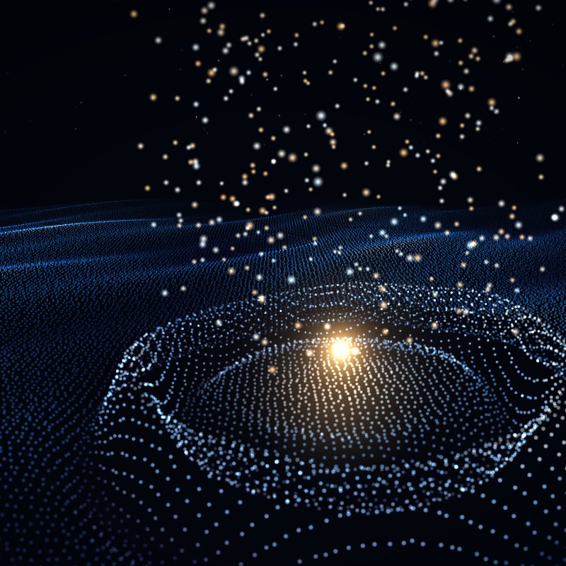

# 光潮 · Lumen Tide

**[▶ Play / 打开玩](https://lotushansstudio-maker.github.io/visual/lumen-tide/)**



**中文**：一片由几万个光点组成的夜海。用鼠标、手指、键盘或者对着摄像头挥手，引导一颗光球掠过海面，压出尾迹，激起涟漪和水花。溅起的每颗水珠都沿抛物线落回海面，落点再激起一圈小涟漪。

**English**: A night sea made of tens of thousands of points of light. Guide a glowing orb across it with the mouse, a finger, the keyboard or a wave at the camera; it presses a wake into the surface and throws up ripples and splashes. Every droplet falls back along a parabola and sets off a small ripple of its own.

## 怎么玩 · How to play

| 操作 Action | 效果 Effect |
| --- | --- |
| 移动鼠标 / 手指拖动 · Move / drag | 光球跟着走，拖出凹陷和尾迹 · the orb follows and leaves a wake |
| 点一下 · Tap | 溅起水花，涟漪一圈圈荡开 · a splash and spreading ripples |
| 按住再松开 · Hold, then release | 光球下潜蓄力，按得越久爆发越大 · the orb dives and charges; the longer you hold, the bigger the burst |
| 第二根手指 · Second finger | 在那个位置直接溅起水花 · splash right there |
| 「摄像头」/ `C` · Camera | 对着镜头挥手控制光球，用力一挥溅起水花 · wave at the lens to steer; a hard swipe splashes |
| 方向键 / WASD + 空格 · Arrows / WASD + space | 键盘移动光球，空格相当于按住 · move with keys, space = hold |
| `1` `2` `3` / 「换色」· Colour | 夜海 · 熔金 · 极光 · Night Sea, Molten Gold, Aurora |
| 「EN / 中」 | 中英切换，和主页共用 · switch language (shared with the homepage) |

不动它的时候，光球会自己在海上画“8”字巡游。Left alone, the orb cruises a figure-eight on its own.

## 数学 · The maths

海面是一个二维波动方程（Hugo Elias 涟漪算法）：
The sea surface is a 2D wave equation (the Hugo Elias ripple method):

```
u'(x,z) = [ ½ · (u(x−1) + u(x+1) + u(z−1) + u(z+1)) − u⁻(x,z) ] × 0.986
```

光球的“压”和水花的“冲击”都写进这个高度场；屏幕上的点通过透视相机的射线与海面求交，得到光球位置。
The orb's press and each splash are written into this height field; screen points are ray-cast through a perspective camera onto the sea to place the orb.

## 灵感来源 · Inspiration

- David Katz（HTC VIVE 创意总监）的手势控制粒子海浪模拟，约 10 万个粒子，用手推着一颗球穿过波浪。报道：[80 Level — Impressive Particle Simulator Controlled by Hand Gestures](https://80.lv/articles/impressive-particle-simulator-controlled-by-hand-gestures)
- David Katz's hand-controlled particle wave simulation (about 100k particles). Written from scratch; no code from the original.

## 技术 · Tech

- 原生 WebGL，无外部库；点精灵 + 叠加混合产生发光感 · Raw WebGL, no libraries; additive point sprites
- CPU 上的波动方程高度场，固定 60Hz 步长 · Wave-equation height field on the CPU at a fixed 60 Hz step
- 摄像头用帧差法找“在动的像素”求重心，不下载任何模型 · Camera control by frame differencing, no ML model to download
- 单文件 `index.html`，手机 / 电脑 / 触摸 / 竖屏都能玩 · Single file; works on phone and desktop, touch and portrait

> 摄像头需要 HTTPS，GitHub Pages 默认就是；本地双击打开时鼠标 / 触摸 / 键盘都能玩。The camera needs HTTPS (GitHub Pages provides it).

No.003 · 2026-11-26 · [All pieces 全部作品](https://lotushansstudio-maker.github.io/visual/)
