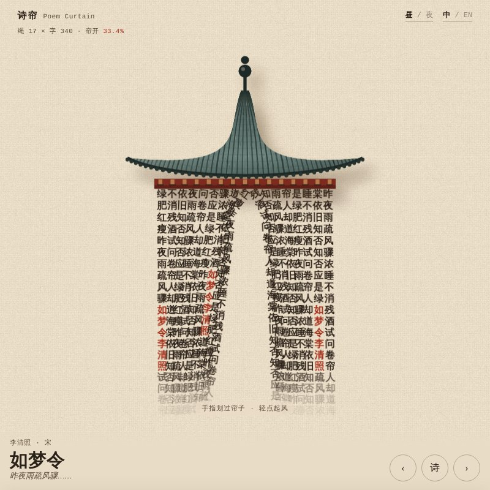

# 诗帘 · Poem Curtain

**[▶ Play / 打开玩](https://lotushansstudio-maker.github.io/visual/poem-curtain/)**

**中文**：屋檐下垂着一列列竖排古诗串成的帘子。鼠标拂过、手指划过，像拨开一挂布帘；松手后它慢慢晃回原位。五首诗配五种中国屋顶。

**English**: Verses hang from Chinese eaves as curtains of characters, one vertical line per rope. Brush through them and they part like cloth, then sway slowly back. Five poems, five roofs.

## 怎么玩 · How to play

| 操作 Action | 效果 Effect |
| --- | --- |
| 鼠标拂过 / 手指划过 · Hover / swipe | 拨开帘子 · part the curtain |
| 按住拖动 · Drag | 拨得更开 · part it wider |
| 单击 / 轻点 · Click / tap | 起一阵风 · a gust of wind |
| ← → / ‹ › / 缩略图 · Arrows / thumbnails | 换下一首诗，屋子滑过、帘子甩一下 · next poem; the house slides and the curtain swings |
| 「昼 / 夜」 | 宣纸墨字，或夜里暖光字 · ink on paper, or glowing script at night |
| 「中 / EN」 | 中英切换，和主页共用 · switch language (shared with the homepage) |

## 五首诗 · Five poems

| 诗 Poem | 屋顶 Roof |
| --- | --- |
| 李白《玉阶怨》 Li Bai, *Jade Steps Lament* — 却下水晶帘 | 庑殿顶 · 宫 Hip roof, palace |
| 李清照《如梦令》 Li Qingzhao, *As in a Dream* — 试问卷帘人 | 攒尖顶 · 亭 Pyramidal roof, pavilion |
| 刘禹锡《陋室铭》 Liu Yuxi, *Ode to a Humble Room* — 草色入帘青 | 马头墙 · 徽州民居 Horse-head walls, Huizhou house |
| 王之涣《登鹳雀楼》 Wang Zhihuan, *On Stork Tower* — 更上一层楼 | 重檐 · 楼 Double eaves, tower |
| 杜牧《江南春》 Du Mu, *Spring South of the River* — 四百八十寺 | 歇山顶 · 寺 Gable-hip roof, temple |

诗文均为公版古诗，英文为自译；屋顶全部用 Canvas 程序绘制。All poems are public domain; translations are my own; every roof is drawn in code.

## 数学 · The maths

每列帘子是一根 Verlet 绳，每个字是一个质点。Each rope is a Verlet chain, one glyph per particle:

`x(n+1) = 2·x(n) − x(n−1) + g·Δt²`

绳长约束迭代 5 次；同一行相邻的绳保持最小间距、不会互相穿过，所以拨开后两边的字会堆成褶皱。左上角的「帘开」是偏离静止位置的字所占的比例。
Length constraints are relaxed 5 times per step; neighbouring ropes keep a minimum gap so they can't pass through each other, which is what makes the folds. The “open” readout is the share of glyphs displaced from rest.

## 来源 · Credit

灵感来自 Instagram [@crove.lab](https://www.instagram.com/crove.lab/) 的网页作品：印尼传统屋顶下垂着字母帘子。本作从头编写，换成了竖排中文诗与中国古建筑。
Inspired by @crove.lab's web piece of letter curtains under Indonesian roofs. Written from scratch here with vertical Chinese verse and Chinese roofs.

单文件 `index.html`，不用外部库。Single `index.html`, no libraries.
