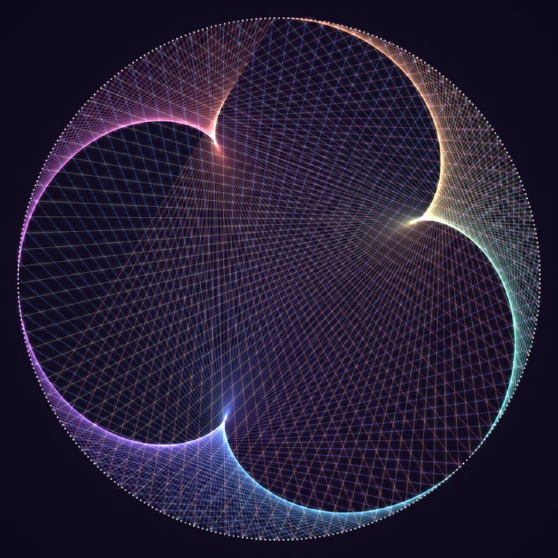

# String Mandala · 弦线曼陀罗

**[▶ Play / 打开玩](https://lotushansstudio-maker.github.io/visual/string-mandala/)**

**EN** · 360 pins on a circle; pin *i* is tied to pin *i × k*. Drag *k* and hundreds of glowing strings flow from a cardioid into a nephroid, then into a flower.

**中文** · 圆上 360 颗钉子，第 i 颗连到第 i × k 颗。拖动 k，几百根发光的弦从心形线流向肾形线，再变成花。

## How to play · 怎么玩
| | Phone 手机 | Desktop 电脑 |
|---|---|---|
| Change k 改变 k | drag sideways 左右拖 | drag / wheel / ↑↓ 拖 / 滚轮 |
| Jump to next integer 跳整数 | — | ← → / 0–9 |
| Pluck 拨弦 | tap 点一下 | click / Space 点击 / 空格 |
| Colour 配色（Neon 霓虹 / Gold 金箔 / Celadon 青瓷 / Cinnabar 朱砂） | button 按钮 | C |
| Pins 钉数 200 / 360 / 600 / 1000 | button 按钮 | P |
| Auto drift 自动漂移 | button 按钮 | A |
| Save PNG 保存 | button 按钮 | S |
| Language 语言 | top right 右上角 | L |

Release slowly and *k* snaps to the nearest whole number with a flash, showing the curve's name. 慢慢松手，k 会吸附到最近的整数并闪一下，显示曲线名字。

URL params 网址参数：`?k=3&pal=1&n=600&lang=en`

## The maths · 数学
k = 2 gives a cardioid, k = 3 a nephroid, k = n an epicycloid with n − 1 cusps. Between integers the envelope flows from one to the next. 
k = 2 是心形线，k = 3 是肾形线，k = n 是 n−1 瓣外摆线；k 不是整数时包络在两者之间流动。

## Inspiration · 灵感
- Mathologer (Burkard Polster) · [Times Tables, Mandelbrot and the Heart of Mathematics](https://www.youtube.com/watch?v=qhbuKbxJsk8)
- String art and Mary Everest Boole's "curve stitching" 弦线艺术与曲线缝纫

Written from scratch, one HTML file, no libraries. 从头手写，单个 HTML 文件，无外部库。

## Tech · 技术
Canvas 2D · strings on a transparent layer faded with `destination-out` for silky trails 拖影 · additive `lighter` glow, `multiply` ink for the light palette · cheap bloom by downscaling 缩放柔光（iOS Safari 可用）· strings batched into 36 colour groups 分组批量描边 · plucked strings drawn as quadratic curves with a travelling, decaying wave 拨弦波 · inertia + spring snapping 惯性与吸附.

© Hanyu (Lotus) Ke
